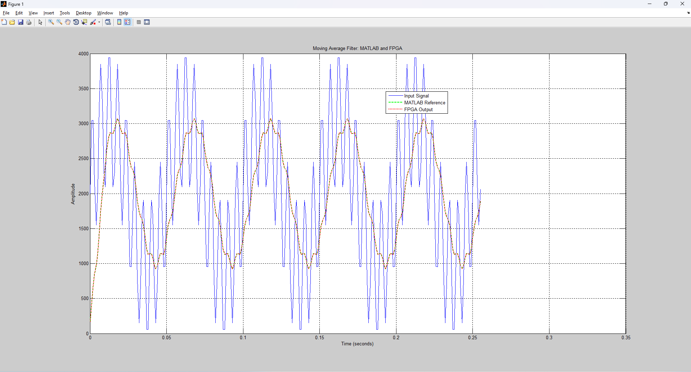

# FPGA-Based Moving Average Filter Using MATLAB and ZedBoard

An FPGA-based Digital Signal Processing (DSP) project that implements a moving-average filter using Verilog HDL on a Xilinx ZedBoard (Zynq-7000 SoC). MATLAB generates the input signal, communicates with the FPGA through UART, and compares the hardware output against a software reference model.

The project integrates MATLAB, embedded C, AXI GPIO, and custom RTL to demonstrate real-time hardware/software interaction for digital signal processing.

---

## Table of Contents

- [1. Project Overview](#1-project-overview)
- [2. Objectives](#2-objectives)
- [3. Hardware and Software Requirements](#3-hardware-and-software-requirements)
- [4. System Architecture](#4-system-architecture)
- [5. How the Project Works](#5-how-the-project-works)
- [6. Moving Average Filter Theory](#6-moving-average-filter-theory)
- [7. Input Signal Generation](#7-input-signal-generation)
- [8. Hardware and Software Interface](#8-hardware-and-software-interface)
- [9. UART Communication Protocol](#9-uart-communication-protocol)
- [10. Project Directory Structure](#10-project-directory-structure)
- [11. Implementation Procedure](#11-implementation-procedure)
- [12. MATLAB Processing and Verification](#12-matlab-processing-and-verification)
- [13. Results and Analysis](#13-results-and-analysis)
- [14. Troubleshooting](#14-troubleshooting)
- [15. Filter Hardware Performance Analysis](#15-filter-hardware-performance-analysis)
- [16. Applications](#16-applications)
- [17. Future Improvements](#17-future-improvements)
- [18. Author](#18-author)

---

## 1. Project Overview

Digital signal processing algorithms are commonly implemented in software using tools such as MATLAB. However, FPGA hardware can execute signal-processing operations using dedicated digital logic and parallel hardware structures.

This project demonstrates how a moving-average filter can be implemented in FPGA programmable logic and controlled by an embedded processor.

MATLAB generates a digital input signal and sends samples to the ZedBoard using UART. The Zynq Processing System receives the samples and transfers them to the custom Verilog moving-average filter through AXI GPIO. The filtered output is returned to MATLAB, where it is compared with the expected software result.

### Key Features

- Digital signal generation using MATLAB.
- Moving-average filter implementation using Verilog HDL.
- MATLAB-to-FPGA communication using UART.
- ARM processor and FPGA programmable-logic integration.
- AXI GPIO interface for sample and control-signal transfer.
- MATLAB reference-model comparison.
- Waveform visualization and numerical error analysis.
- Support for investigating different moving-average window sizes.

---

## 2. Objectives

1. Understand the implementation of DSP algorithms in FPGA hardware.
2. Generate digital input samples using MATLAB.
3. Implement a moving-average filter in Verilog HDL.
4. Transfer samples between MATLAB and the Zynq processor using UART.
5. Connect processor software to custom FPGA logic using AXI GPIO.
6. Compare hardware results against a MATLAB reference model.
7. Investigate numerical mismatches and FPGA timing constraints.
8. Study how filter window size affects signal smoothing and hardware implementation.

---

## 3. Hardware and Software Requirements

### Hardware

| Component | Purpose |
|---|---|
| Xilinx ZedBoard | FPGA development platform |
| Zynq-7000 SoC | ARM processor and programmable logic |
| PC or laptop | MATLAB execution and FPGA development |
| USB-UART connection | Serial communication with MATLAB |
| USB programming connection | FPGA configuration and debugging |

### Software

| Software | Purpose |
|---|---|
| MATLAB R2013a | Signal generation, UART communication, reference calculation and plotting |
| Xilinx Vivado | Hardware design, synthesis, implementation and bitstream generation |
| Xilinx Vitis | Embedded C application development |
| Verilog HDL | Moving-average filter RTL |
| C | Processor-side UART and AXI GPIO control |

**Configuration:** The project uses a 100 MHz configured Zynq fabric clock and UART communication at 115200 baud. Confirm the actual clock used by the filter and the generated hardware configuration before reporting final performance.

---

## 4. System Architecture

### Block Diagram

```text
+--------------------------------+
|          MATLAB (PC)            |
|                                |
|  Input Signal Generation       |
|  Reference Filter              |
|  Result Comparison             |
|  Waveform Visualization        |
+---------------+----------------+
                |
                | UART
                | COM3, 115200 baud
                v
+--------------------------------+
|      Zynq Processing System     |
|                                |
|  ARM Cortex-A9 Processor       |
|  Embedded C Application        |
|  UART Reception / Transmission |
+---------------+----------------+
                |
                | AXI4-Lite
                v
+--------------------------------+
|            AXI GPIO             |
|                                |
|  Channel 1: Sample + Valid     |
|  Channel 2: Result + Valid     |
+---------------+----------------+
                |
                | Parallel GPIO
                v
+--------------------------------+
|     Programmable Logic (PL)     |
|                                |
|  Moving Average Filter RTL     |
|  Sample Buffer / Accumulator   |
|  Filtered Output               |
+---------------+----------------+
                |
                +------ Result returns through
                        AXI GPIO -> ARM -> UART
                        -> MATLAB
```

### Main Design Components

**1. MATLAB**

Generates the input signal, sends samples through UART, receives filtered values, calculates a reference output, and plots the results.

**2. Processing System (PS)**

The Zynq-7000 ARM Cortex-A9 processor executes the embedded C application. It handles UART communication and accesses the AXI GPIO peripheral.

**3. AXI Interconnect**

Routes AXI transactions from the processor to the AXI GPIO peripheral.

**4. AXI GPIO**

Transfers the sample data and control signals between the processor and custom programmable-logic design.

**5. Programmable Logic (PL)**

Contains the custom Verilog moving-average filter that performs the digital filtering operation.

---

## 5. How the Project Works

The project operates in the following sequence.

### Step 1: Generate the Input Signal

MATLAB creates a signal containing a DC offset and two sinusoidal components. The floating-point signal is converted into integer samples.

### Step 2: Open UART Communication

MATLAB opens COM3 at 115200 baud. Each sample is transmitted as two bytes in little-endian order.

### Step 3: Receive Data in the Processor

The Zynq ARM processor receives the incoming sample bytes through its UART peripheral and reconstructs the 16-bit sample.

### Step 4: Transfer the Sample to the FPGA

The embedded C application writes the sample to AXI GPIO Channel 1 and asserts the sample-valid control bit.

### Step 5: Process the Sample in RTL

The Verilog moving-average filter updates its sample history, calculates the sum over the configured window, and produces the filtered output.

### Step 6: Return the Filtered Result

The RTL interface exposes the filtered output and an output-valid indication through AXI GPIO Channel 2. The processor reads the output when the handshake indicates that it is ready.

### Step 7: Send the Result to MATLAB

The processor transmits the filtered value as two UART bytes. MATLAB reconstructs the 16-bit result.

### Step 8: Verify the Output

MATLAB computes the expected moving-average output, compares it with the FPGA result, calculates errors, and displays waveform plots.

**Important:** The Vitis application and RTL wrapper must use the same handshake protocol. The software must wait for a valid result before transmitting it to MATLAB.

---

## 6. Moving Average Filter Theory

A moving-average filter smooths a digital signal by averaging a fixed number of consecutive samples.

### Moving Average Filter Formula

For a window size of `M`, the output is calculated as:

**Formula:**

`y[n] = (1/M) × Σ x[n-k]`, for `k = 0` to `M-1`

**Where:**
- `x[n]` — Current input sample.
- `y[n]` — Filtered output sample.
- `M` — Number of samples in the averaging window.
- `k` — Index used to access the input samples.

**Example:** For `M = 4`,

`y[n] = (x[n] + x[n-1] + x[n-2] + x[n-3]) / 4`

The filter averages the current sample and the previous three samples to produce a smoother output.
### Example: Four-Point Moving Average

Suppose the input samples are:

```text
100, 200, 300, 400, 500, ...
```

The first four-point output, using zero-padding at startup, is:

### Example: Moving Average Filter Calculation

For a window size of `M = 4`, the output samples are calculated as follows.

**First output:**

`y[0] = (100 + 0 + 0 + 0) / 4 = 25`

**Second output:**

`y[1] = (200 + 100 + 0 + 0) / 4 = 75`

**Fourth output:**

`y[3] = (400 + 300 + 200 + 100) / 4 = 250`

**Explanation:** Initially, the previous samples are assumed to be zero. As new samples arrive, the filter averages the current sample and the previous three samples to generate the output.
Once the window is filled, the filter averages the latest four input samples.

### Filter Configurations

| Window size | Samples averaged | Division factor |
|---|---:|---:|
| 4-point | 4 | 4 |
| 8-point | 8 | 8 |
| 12-point | 12 | 12 |

A larger window generally produces stronger smoothing, but it also requires more sample history and can increase arithmetic and storage requirements.

For correct verification, the MATLAB reference and RTL must use the same window size, initial-state convention, and rounding behavior.

---

## 7. Input Signal Generation

The MATLAB input signal is generated using:

```matlab
N = 256;
Fs = 1000;

n = 0:N-1;
t = n/Fs;

x = 2000 ...
    + 1000*sin(2*pi*20*t) ...
    + 500*sin(2*pi*180*t);

samples = round(x);
```

### Signal Parameters

| Parameter | Value |
|---|---:|
| Number of samples | 256 |
| Sampling frequency | 1000 Hz |
| Sampling interval | 0.001 seconds |
| DC offset | 2000 |
| First sinusoidal frequency | 20 Hz |
| Second sinusoidal frequency | 180 Hz |
| Sample representation | Integer samples |

The generated samples are transmitted to the FPGA for processing.

---

## 8. Hardware and Software Interface

### UART Interface

UART provides serial communication between the PC and the Zynq processor.

| Parameter | Configuration |
|---|---|
| COM port | COM3 |
| Baud rate | 115200 |
| Data bits | 8 |
| Parity | None |
| Stop bits | 1 |
| Flow control | None |
| Sample format | 16-bit unsigned integer, low byte first |

The actual COM number may differ between computers and USB connections. Verify it using Windows Device Manager.

### AXI GPIO Interface

The design uses two GPIO channels, each configured for 17-bit data.

| Channel | Direction | Data bits | Control bit |
|---|---|---|---|
| Channel 1 | Processor to PL | Bits [15:0]: input sample | Bit [16]: sample-valid |
| Channel 2 | PL to processor | Bits [15:0]: filtered output | Bit [16]: output-valid |

The embedded application writes the input sample and reads the filtered output through the AXI GPIO peripheral.

**Handshake requirement:** The RTL and C application must agree on when the sample-valid signal is asserted, when output-valid is asserted, and when both signals are cleared.

---

## 9. UART Communication Protocol

Each input sample is represented using two bytes.

For a sample value \(S\):

**Formula:**

`S = LowByte + (256 × HighByte)`

The MATLAB code creates the bytes as follows:

```matlab
sample = uint16(samples(k));

lowByte = uint8(bitand(sample, 255));
highByte = uint8(bitshift(sample, -8));

fwrite(s, [lowByte highByte], 'uint8');
```

The output is reconstructed using:

```matlab
response = fread(s, 2, 'uint8');

fpga_output(k) = double(response(1)) ...
               + 256*double(response(2));
```

This protocol assumes the FPGA-side software transmits exactly two response bytes for every accepted sample. Both sides must use the same byte order and sample format.

---

## 10. Project Directory Structure

A recommended repository structure is:

```text
FPGA-Moving-Average-Filter/
|
+-- README.md
|
+-- rtl/
|   +-- moving_average.v
|   +-- dsp_gpio_wrapper.v
|   +-- testbench/
|
+-- matlab/
|   +-- moving_average.m
|
+-- vitis/
|   +-- src/
|       +-- main.c
|
+-- vivado/
|   +-- constraints/
|   |   +-- design.xdc
|   +-- scripts/
|       +-- build.tcl
|
+-- results/
|   +-- figures/
|   |   +-- input_signal.png
|   |   +-- output_comparison.png
|   |   +-- error_analysis.png
|   +-- data/
|       +-- DSP_Results.csv
|
+-- docs/
    +-- block_diagram.png
    +-- timing_summary.png
    +-- utilization_report.png
```

Only include files that exist in the project. Keep generated Vivado run folders and large build artifacts out of Git unless they are intentionally needed.

---

## 11. Implementation Procedure

### A. Vivado Hardware Design

1. Create or open the Vivado project for the ZedBoard.
2. Add and configure the Zynq-7000 Processing System.
3. Enable the processor clock and required UART interface.
4. Enable the processor AXI master interface.
5. Add the AXI Interconnect and AXI GPIO IP.
6. Configure AXI GPIO for two 17-bit channels.
7. Add the custom moving-average filter and GPIO wrapper.
8. Connect the AXI, clock, reset, and data interfaces.
9. Assign addresses and validate the block design.
10. Run synthesis and implementation.
11. Inspect timing and resource-utilization reports.
12. Generate the bitstream and export the hardware platform as an XSA file.

### B. Vitis Embedded Software

1. Create an application targeting the exported hardware platform.
2. Select the Zynq-7000 ARM processor and an appropriate standalone domain.
3. Configure the UART driver and AXI GPIO driver.
4. Receive two-byte input samples through UART.
5. Write the sample and valid bit to GPIO Channel 1.
6. Wait for the output-valid indication.
7. Read the filtered sample from GPIO Channel 2.
8. Send the result back to MATLAB as two bytes.

The exact device IDs and base addresses must come from the generated hardware platform and `xparameters.h`.

### C. MATLAB Execution

1. Connect the ZedBoard to the PC using its UART USB connection.
2. Confirm the correct COM port in Device Manager.
3. Program the FPGA with the corresponding bitstream.
4. Start the Vitis application.
5. Run the MATLAB script.
6. Check that all expected samples are received.
7. Compare FPGA results with the MATLAB reference.
8. Save the numerical results and waveform screenshots.

---

## 12. MATLAB Processing and Verification

MATLAB performs the following tasks:

- Generates the input signal.
- Transmits samples over UART.
- Receives filtered results.
- Calculates the software reference.
- Plots the input and output signals.
- Computes the error between reference and FPGA output.
- Saves the results for documentation.

### Reference Model

For a four-point moving-average filter with zero-padding at startup:

```matlab
windowSize = 4;
reference = zeros(length(samples), 1);

for k = 1:length(samples)
    firstIndex = max(1, k-windowSize+1);

    reference(k) = floor( ...
        sum(samples(firstIndex:k)) / windowSize);
end
```

This reference model divides by the full window size even when fewer than four actual samples are available. Use the same convention in the RTL to achieve matching results.

### Error Calculation

The FPGA output is compared with the MATLAB reference output to verify the correctness of the moving average filter.

**1. Sample Error**

`e[n] = y_FPGA[n] - y_reference[n]`

- `y_FPGA[n]` — Output generated by the FPGA.
- `y_reference[n]` — Expected output calculated in MATLAB.
- `e[n]` — Difference between the two outputs.

**2. Maximum Absolute Error**

`E_max = max(|e[n]|)`

This represents the largest absolute difference between the FPGA output and the MATLAB reference output.

**3. Number of Mismatched Samples**

`N_mismatch = Count of samples where e[n] ≠ 0`

This indicates the total number of samples for which the FPGA output differs from the MATLAB reference output.

**Interpretation:**

- **Zero error:** The FPGA output matches the MATLAB reference.
- **Non-zero error:** A difference exists between the outputs.


## 13. Results and Analysis

### Waveform Comparison

Add the actual waveform screenshot from MATLAB.


The comparison should include:

- Input signal.
- MATLAB reference output.
- FPGA output.

The moving-average output should generally appear smoother than the input signal.

### Numerical Results

The MATLAB analysis should save the following columns:

| Column | Description |
|---|---|
| Sample Index | Position of the sample in the sequence |
| Time (s) | Sampling time |
| Input Sample | Original signal sample |
| MATLAB Reference | Expected moving-average output |
| FPGA Output | Measured hardware output |
| Error | FPGA output minus reference |

### Verification Status

| Test | Status |
|---|---|
| UART connection on COM3 | Previously demonstrated |
| Transfer of 256 samples | Previously completed successfully in an earlier run |
| Four-point filter | Matching outputs observed after initial samples in the supplied comparison |
| Eight-point filter | Requires further verification |
| Twelve-point filter | Requires further verification |
| Timing constraints | A timing violation was reported; optimization is required |

**Note:** Results depend on the current RTL, bitstream, and Vitis application. Repeat the tests after changes and update this table with the latest measured results.

---

## 14. Troubleshooting

### UART Timeout

**Symptom:** MATLAB reports that the expected response was not received.

Possible checks:

- Verify the correct COM port.
- Confirm that the Vitis application is running.
- Confirm the correct bitstream is programmed.
- Check that no other terminal is using the UART.
- Verify the baud rate and byte order.
- Check the sample-valid/output-valid handshake.

### FPGA and MATLAB Outputs Differ

Possible causes:

- Different window sizes.
- Incorrect accumulator width.
- Incorrect startup behavior.
- Rounding or integer-division differences.
- Stale output values or incorrect handshake timing.
- Byte-order or sample-alignment errors.
---
 - Video link - [https://drive.google.com/file/d/15ZKwI3JTuDE7ShU6SKsqxNZ1-sTxZ7om/view?usp=sharing](url)
 -  Output sheet link - [https://docs.google.com/spreadsheets/d/1_KEN69zjv6rx97owJ5PKCCP_mXthMQ2X/edit?usp=sharing&ouid=111938485143431863520&rtpof=true&sd=true](url)
---

## 15. Applications

Moving-average filters are useful in:

- Sensor signal smoothing.
- Embedded measurement systems.
- Noise reduction in sampled data.
- Basic digital signal processing demonstrations.
- FPGA-based signal-processing pipelines.
- Hardware/software co-design education.

---

## 16.Filter Hardware Performance Analysis

This section presents the FPGA implementation results for 16-bit FIR filters with 4, 8, and 12 taps. The comparison evaluates hardware resource utilization, timing performance, estimated on-chip power, and routing complexity.

### Implementation Results

| Performance Metric | 4-Tap FIR | 8-Tap FIR | 12-Tap FIR |
|:--|--:|--:|--:|
| Input Data Width | 16 bits | 16 bits | 16 bits |
| LUTs Used | 470 | 506 | 651 |
| LUTRAM | 60 | 60 | 60 |
| Flip-Flops (FFs) | 781 | 845 | 909 |
| BUFG | 1 | 1 | 1 |
| WNS (ns) | +4.129 | +2.103 | **−0.475** |
| Estimated On-Chip Power (W) | 1.695 | 1.712 | 1.714 |
| Fully Routed Nets | 1,324 | 1,464 | 1,653 |

### Performance Observations

- **Resource Utilization:** LUT usage increases from 470 to 651, while flip-flop usage increases from 781 to 909 as the filter length increases.
- **Timing Performance:** WNS decreases from +4.129 ns for the 4-tap filter to +2.103 ns for the 8-tap filter. The 12-tap filter has a negative WNS of −0.475 ns.
- **Power Consumption:** Estimated on-chip power increases from 1.695 W to 1.714 W across the tested configurations.
- **Routing Complexity:** Fully routed nets increase from 1,324 to 1,653 as the filter length increases.

### Timing Analysis

The 4-tap and 8-tap configurations have positive Worst Negative Slack (WNS), indicating positive timing slack for the paths covered by the timing analysis.

The 12-tap configuration has a **WNS of −0.475 ns**, indicating that the worst analyzed timing path violates its required timing by 0.475 ns. Timing optimization is therefore required if the design must meet the current clock constraints.

Potential optimization approaches include pipelining the arithmetic operations, balancing the adder tree, and reviewing the critical path in Vivado's timing reports.

### Conclusion

Increasing the filter length increases hardware resource utilization and routing complexity. The 4-tap configuration provides the largest timing margin and lowest LUT usage among the tested configurations, while the 12-tap configuration requires additional timing optimization.

These results demonstrate the trade-off between filter length, hardware cost, and timing performance in FPGA-based digital signal processing.

*Note: All measurements are specific to the tested implementation. For a fair comparison, use consistent FPGA device settings, clock constraints, implementation settings, and power-analysis assumptions.*


## 17. Future Improvements

- Verify multiple window sizes, including 4, 8, and 12 points.
- Improve the sample-valid/output-valid handshake.
- Add automated test vectors and regression testing.
- Optimize the RTL for timing closure.
- Measure FPGA resource utilization.
- Extend the design to FIR filters, FFT processing, and additional DSP algorithms.

---

## 18. Author

**Name:** Naveenraj S  
**Department:** Electronics and Communication Engineering  
**Institution:** Bannari Amman Institute of Technology  
**LinkedIn:** [Naveenraj S](https://www.linkedin.com/in/naveenraj07/)
### Project Summary

This project demonstrates the integration of MATLAB-based DSP analysis, embedded C software, UART communication, AXI GPIO, and Verilog RTL on a Zynq-7000 FPGA platform. It provides a practical workflow for validating a hardware DSP implementation against a software reference.

